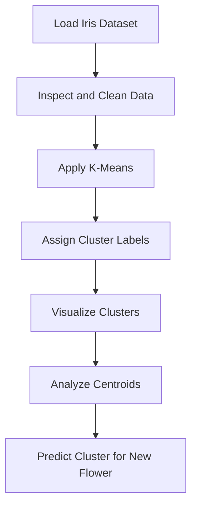

# 🌸 Iris Flower Clustering using K-Means

<p align="center">
  
  
  
</p>

<p align="center">
  An unsupervised machine learning project to group Iris flowers using K-Means clustering.
</p>

## 📌 Overview

This project applies the K-Means clustering algorithm to the Iris dataset to discover groups of flowers based on their sepal and petal measurements. It includes data inspection, cluster visualization, centroid analysis, and prediction for a new flower.

## ✨ Key Features

- Loads the Iris dataset using Scikit-learn.
- Checks dataset dimensions, data types, and missing values.
- Applies K-Means clustering with three clusters.
- Visualizes clusters using petal length and petal width.
- Displays cluster centroids.
- Predicts the cluster of a new flower.

## 📊 Dataset

- **Source:** Scikit-learn built-in Iris dataset
- **Samples:** 150
- **Features:** 4 numerical features
- **Missing values:** 0

The dataset is loaded directly using `load_iris()`, so no separate dataset file is required.

## ⚙️ Workflow



## 🤖 Algorithm

**K-Means Clustering**
- Number of clusters: 3
- Random state: 42
- Initializations: 10

K-Means groups flowers according to similarities in their feature values. The cluster labels are generated by the algorithm and do not directly represent the actual Iris species labels.

## 🛠️ Tech Stack

| Technology | Purpose |
|---|---|
| Python | Programming language |
| Pandas | Data handling and inspection |
| Matplotlib | Cluster visualization |
| Scikit-learn | Dataset loading and K-Means clustering |
| Google Colab | Notebook development |

## 📁 Repository Structure

```text
Iris-Flower-Clustering/
├── Iris_Clustering.ipynb
├── README.md
└── requirements.txt
```

## 🚀 Getting Started

1. Clone the repository:

   ```bash
   git clone https://github.com/tanush090/Iris-Flower-Clustering.git
   ```

2. Navigate to the project folder:

   ```bash
   cd Iris-Flower-Clustering
   ```

3. Install dependencies:

   ```bash
   pip install -r requirements.txt
   ```

4. Open `Iris_Clustering.ipynb` in Jupyter Notebook or Google Colab and run the cells.

## 🔮 Future Improvements

- Compare clustering results with actual Iris species labels.
- Evaluate clustering performance using metrics such as the Silhouette Score.
- Experiment with different numbers of clusters and feature combinations.

## 👨‍💻 Author

**Tanush Kumar**

- GitHub: [@tanush090](https://github.com/tanush090)

---

<p align="center">Built to explore unsupervised machine learning through practical implementation. 🚀</p>
